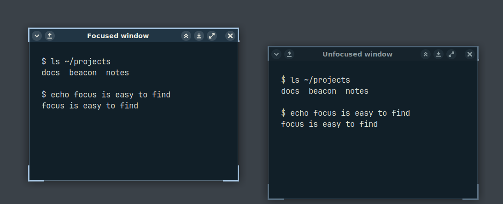
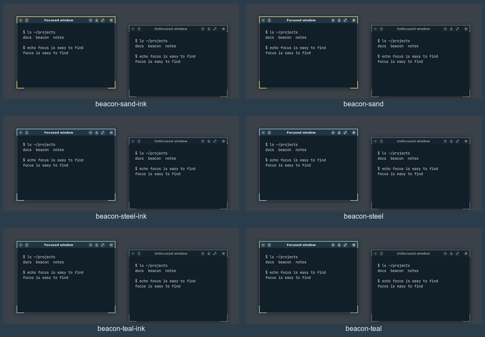
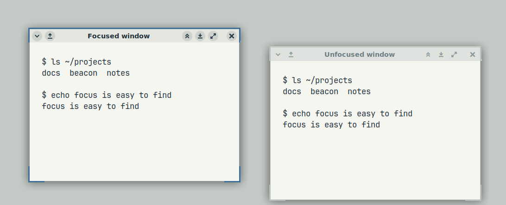
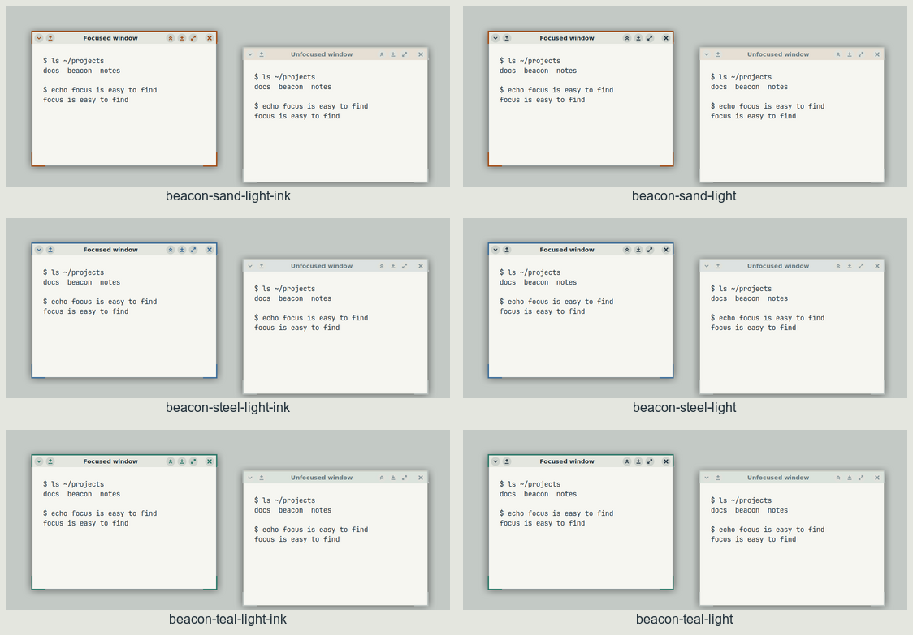
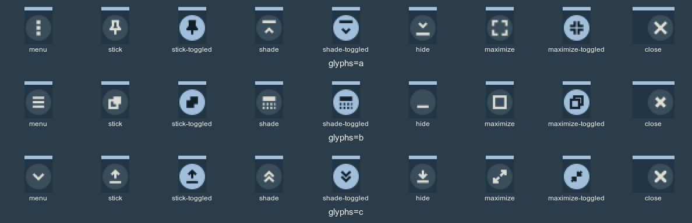
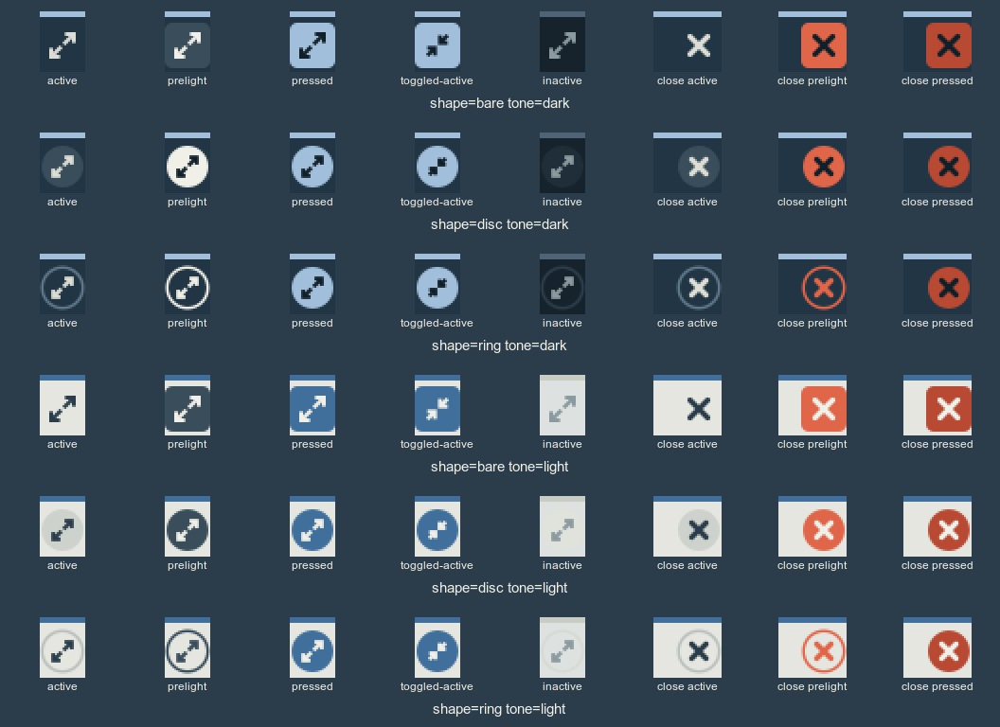
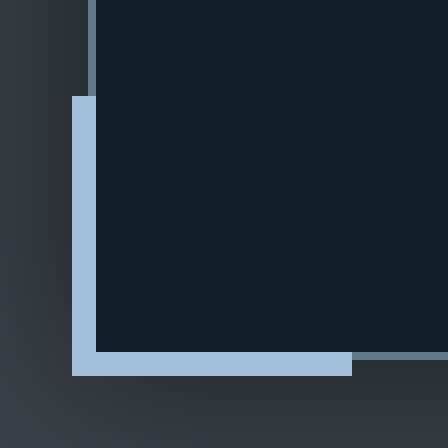

# xfce4-beacon-theme

xfwm4 window decorations (borders, title bar, buttons) for Xfce, built so that:
- the focused window is identifiable at a glance;
- the resize corners are visible.



> **Built with LLM assistance.** The scripts, generated artwork and documentation
> in this repository were written with Claude (Anthropic) under the maintainer's
> direction.

Tested with xfwm4 4.20.0 (Xfce 4.20) on X11.

Contents:
- [Quick start](#quick-start)
- [Themes](#themes)
- How-to guides
  - [Install](#install)
  - [Switch themes](#switch-themes)
  - [Uninstall](#uninstall)
  - [Make your own theme](#make-your-own-theme)
  - [Check a change](#check-a-change)
  - [Regenerate the screenshots](#regenerate-the-screenshots)
  - [Make a release](#make-a-release)
- Reference
  - [beacon.conf](#beaconconf)
  - [Theme keys](#theme-keys)
  - [Glyph sets](#glyph-sets)
  - [Button states](#button-states)
  - [Scripts](#scripts)
  - [Build constants](#build-constants)
- Design notes
  - [The focus cue](#the-focus-cue)
  - [Unfocused tint](#unfocused-tint)
  - [Resize handles](#resize-handles)
  - [Colour vision](#colour-vision)
- [Limits](#limits)
- [Licence](#licence)

## Quick start

Install the latest release, with nothing to build:

```
curl -fsSLO https://gitlab.com/wamp3ter/xfce4-beacon-theme/-/raw/main/install.sh
bash install.sh beacon-steel
```

- `install.sh` on its own downloads the latest release and installs every theme
  into `~/.themes`.
- `beacon-steel` also switches xfwm4 to it.
- Needs `curl` and `tar`.

Or build from the repository:

```
git clone https://gitlab.com/wamp3ter/xfce4-beacon-theme.git
cd xfce4-beacon-theme
./build.sh beacon.conf
./install.sh beacon-steel
```

- `./build.sh beacon.conf` renders every theme in `beacon.conf` into `build/`.
- `./install.sh beacon-steel` copies them into `~/.themes` and switches xfwm4 to
  `beacon-steel`.
- Missing a build tool? See [Install](#install), or build in a container.

## Themes

Twelve themes ship, from three choices:
- accent: steel, teal or sand;
- tone: dark or light title bars;
- glyph colour: neutral, or the accent (`-ink`).

What every theme has:
- **Focused window:** an accent stripe along the top of the title bar, and accent
  brackets on the corners.
- **Unfocused window:** a hint of the accent, and dimmed title text.
- **Frame:** a 1px line along the sides and bottom.
- **Resize corners:** a 32px bracket on each bottom corner.
- **Buttons:**
  - glyphs always drawn, not only on hover;
  - toggled buttons (stick, shade, maximize) filled with the accent;
  - close spaced apart, and red on hover.

### Dark

For dark desktops and dark applications.



| Theme | Accent | Glyphs |
| --- | --- | --- |
| `beacon-steel`, `beacon-steel-ink` | steel `#a1bfdb` | cream, accent |
| `beacon-teal`, `beacon-teal-ink` | teal `#86c4b7` | cream, accent |
| `beacon-sand`, `beacon-sand-ink` | sand `#decc82` | cream, accent |

### Light

For light desktops and light applications.





| Theme | Accent | Glyphs |
| --- | --- | --- |
| `beacon-steel-light`, `beacon-steel-light-ink` | steel `#3f6f9a` | slate, accent |
| `beacon-teal-light`, `beacon-teal-light-ink` | teal `#2f7a6b` | slate, accent |
| `beacon-sand-light`, `beacon-sand-light-ink` | copper `#a24e18` | slate, accent |

Choosing a tone:
- Match the tone to the desktop.
- On a dark wallpaper a light theme's focus cue inverts: the unfocused window's
  pale frame can look brighter than the focused window's darker accent.

All twelve use disc buttons, glyph set c and a 1px line. See
[Make your own theme](#make-your-own-theme) for the alternatives.

## Install

### Requirements

Building:
- bash 4.3 or later
- `rsvg-convert` (from librsvg)
- `bc`
- GNU coreutils (for `realpath -m`)

Switching themes:
- `xfconf-query`, part of Xfce

Notes:
- Install them with your distribution's package manager; package names differ,
  so search for the commands.
- The scripts target Linux and GNU tools; BSD and macOS userlands are not
  supported.
- `build.sh` checks for its tools before starting and lists any that are missing.

### Build and install

```
./build.sh beacon.conf
./install.sh beacon-steel
```

- `install.sh` copies every built theme into `~/.themes`; no root needed.
- With a theme name it also switches xfwm4 to that theme.
- See [Scripts](#scripts) for every option.

### Build in a container

With Docker, nothing else needs installing:

```
rm -rf build && docker build -o build .
./install.sh beacon-steel
```

- Remove `build/` first: `docker build` adds to it instead of replacing it, so
  themes you have since removed would stay behind.
- Another config: `--build-arg CONF=mine.conf`. The file must be inside the
  repository, since only the repository is copied in.

### System-wide

Copy the folders from `build/` into `/usr/share/themes/`.

## Switch themes

Either:
- Settings > Window Manager > Style; or
- `xfconf-query -c xfwm4 -p /general/theme -s beacon-teal-ink`

After rebuilding the theme in use, switch to another and back: xfwm4 reloads a
theme only when its name changes.

## Uninstall

Switch to another theme first, then remove every Beacon theme:

```
xfconf-query -c xfwm4 -p /general/theme -s Default
./install.sh --uninstall
```

Other themes in `~/.themes` are left alone, whatever their names.

## Make your own theme

1. Edit `beacon.conf`, or write your own file (format: [beacon.conf](#beaconconf)).
2. `./build.sh beacon.conf`, or `./build.sh mine.conf` for your own file.
3. `./install.sh <theme>` to install and switch.
4. [Check the change](#check-a-change).

A build that fails on a bad line leaves the previous `build/` in place.

Recipes:

```
# bright accents with every button shape, to compare them (9 themes)
theme try-{colour}-{shape}  colour=cyan,amber,magenta shape=bare,disc,ring

# a solid 8px border, grabbable along the whole edge
theme bold-{colour}  colour=steel,teal line=8 grab=8

# teal, with the bottom-right resize corner in rose
theme beacon-teal-rose  colour=teal br=rose

# the strongest focus cue: no accent on unfocused windows
theme beacon-{colour}  colour=steel,teal,sand inactive=neutral

# mix glyph sets per button
glyphs mine  menu=b stick=a
theme beacon-steel-mine  colour=steel glyphs=mine

# a new accent in both tones; the light tone needs its own darker colour
colour plum        #c4afda
colour plum-light  #6e4f8f
theme beacon-plum        colour=plum
theme beacon-plum-light  colour=plum-light tone=light
```

Choosing a light-tone accent:
- aim for at least 3:1 contrast against the light title bar `#e4e6df`;
- `plum-light` above measures 5:1.

After renaming or dropping themes, `./install.sh --clean` removes the old ones
from `~/.themes`.

## Check a change

- **One theme:** `./install.sh <theme>`, then look at a focused and an unfocused
  window. If the theme was already in use, switch away and back.
- **All themes, side by side:** `./capture.sh` shoots every built theme.
- **Buttons up close:** `./previews.sh` renders every shape and glyph set at 2x.

## Regenerate the screenshots

Every image in `screenshots/` is generated:

```
./build.sh beacon.conf
./capture.sh     # window shots, on a running Xfce desktop
./previews.sh    # button sheets
```

- `capture.sh` switches your desktop through every theme, then restores your
  theme and settings.
- `previews.sh` needs a git checkout, not a downloaded archive.
- See [Scripts](#scripts) for what each needs and writes.

## Make a release

1. Tag the commit with the release notes as the tag message:
   `git tag -a v1.0.0 -m "<release notes>"`.
2. Push the tag: `git push origin v1.0.0`.
3. CI then:
   - stops if the tag has no message;
   - builds the archive with `./dist.sh`;
   - uploads it to the project's package registry;
   - creates the release, with the tag message as its notes.

The Releases page is the changelog.

Every push also runs CI's check job: shellcheck, a full build and archive, then
`./test-install.sh`.

To pack an archive locally: `./dist.sh`, which writes
`dist/xfce4-beacon-theme.tar.gz`.

## beacon.conf

`beacon.conf` describes the themes `build.sh` renders. Its header documents the
same format as this section.

Format:
- one entry per line;
- `#` starts a comment line;
- a comment cannot follow an entry on the same line;
- blank lines are ignored;
- the whole config is checked before anything is built.

Entries:

- `colour <name> <#rrggbb>`: An accent colour, referred to by name from `theme` lines.

- `glyphs <name> [<button>=<set> ...]`: A glyph set: which drawing (a, b or c) each button uses.
  - Buttons: `menu`, `stick`, `shade`, `hide`, `max`, `close`.
  - A button left out uses c.
  - Set `c` (every button from c) is built in.

- `theme <name> colour=<names> [<key>=<value> ...]`: One theme, installed as `<name>`. Keys: [Theme keys](#theme-keys).

Names:
- colour, glyph set and key names: letters, digits, `_` and `-`;
- theme names: also `.`, but not as the first character;
- theme names become folder names;
- `build.sh` stops if two themes would share a name.

Colours in the shipped file:
- steel, teal, sand, rose;
- light-tone partners: steel-light, teal-light, sand-light;
- bright: cyan, yellow, lime, magenta, amber, orange.

## Theme keys

- `colour`: Accent colour names (required). Used for the focus stripe, corner brackets,
  and toggled and pressed buttons.

- `tone`: Title bar.
  - `dark` (default): slate title bars, cream text.
  - `light`: pale title bars, dark text. Needs a darker accent (the `-light`
    colours).

- `inactive`: Unfocused windows. See [Unfocused tint](#unfocused-tint).
  - `tint` (default): a hint of the accent.
  - `neutral`: no accent; the strongest focus cue.

- `shape`: Button background. See [Button states](#button-states).
  - `disc` (default): filled circle.
  - `ring`: circle outline.
  - `bare`: glyph only.

- `glyphs`: A glyph set name. Default `c`. See [Glyph sets](#glyph-sets).

- `ink`: Glyph colour.
  - `cream` (default): neutral.
  - `accent`: the theme's colour.

- `line`: Width of the line along the window, px.
  - `1` (default): hair.
  - `2`: thin.
  - `8`: solid band.

- `knee`: Thickness of the corner brackets, px. Default `3`.

- `grab`: Frame width per side, px. Default `4`.
  - Must be at least `line` and `knee`.
  - A larger `grab` widens the frame, not the grab area. See
    [Resize handles](#resize-handles).

- `mesh`: Fill the frame beyond the line.
  - `0` (default): leave it clear.
  - `1`: a 1px checkerboard of opaque pixels.

- `tl`, `tr`, `bl`, `br`: Focused window's corner colours: top-left, top-right, bottom-left,
  bottom-right.
  - A colour name or `#rrggbb`.
  - Default: the theme's colour.
  - Unfocused corners follow `inactive`.

Numbers (`line`, `knee`, `grab`):
- whole numbers, 1 or more;
- no leading zeros.

Lists:
- `colour`, `tone`, `inactive`, `shape`, `glyphs` and `ink` take comma lists;
- one line then builds every combination;
- `{colour}`, `{tone}`, `{inactive}`, `{shape}`, `{glyphs}` and `{ink}` in the
  name give each combination its own name.

## Glyph sets



| Button | a | b | c |
| --- | --- | --- | --- |
| menu | dots | lines | caret |
| stick | pin | layered squares | rising arrow |
| shade | bar and chevron | rolled-up title | double chevron |
| hide | bar and chevron | underscore | arrow into a bar |
| maximize | corner brackets | square | diagonals |
| close | X | X | round X |

## Button states



| State | Disc, ring | Bare | Close |
| --- | --- | --- | --- |
| hover (prelight) | cream on dark, slate on light | slate square | red |
| pressed | accent fill | accent square | dark red fill |
| toggled | accent fill | accent square | n/a |
| inactive | unfocused window's buttons | same | same |

## Scripts

- `./build.sh <config>`: Renders every theme in a config into `build/`.
  - The config is required; the shipped one is `beacon.conf`.
  - Checks for its tools before starting.
  - On any config error, the previous `build/` stays in place.

- `./install.sh [--clean] [theme]`: Copies every theme into `~/.themes`.
  - `theme`: also switch xfwm4 to it.
  - `--clean`: also remove Beacon themes no longer being installed.
  - Where the themes come from:
    - `build/` next to the script: a repository after `./build.sh`, or an
      unpacked release;
    - a repository without `build/`: it stops and asks for `./build.sh beacon.conf`;
    - the script on its own: it downloads the latest release into a temporary
      folder, installs from it, and removes the folder;
    - it never builds.
  - `BEACON_URL`: another release archive to download.
  - Checks everything before changing anything: the theme must be among those
    being installed, and no destination may be a same-named folder that
    `build.sh` did not create.
  - Copies each theme beside the old one, then swaps it in, so a failed copy
    leaves the old theme in place.

- `./install.sh --uninstall`: Removes every Beacon theme from `~/.themes`.
  - Removes only folders `build.sh` created; it checks a marker line in each
    `themerc`.

- `./capture.sh`: Window screenshots of every built theme, on a running Xfce desktop.
  - Installs the themes and opens three xterms: a backdrop and two windows.
  - Shoots dark themes on a dark backdrop, light themes on a light one.
  - Sorts themes by the tone `build.sh` records in each `themerc`, so custom
    configs work too.
  - Hero shots: `beacon-steel` and `beacon-steel-light` when built, else the
    first theme of each tone.
  - Holds xfwm4's opacity and shadow settings at their stock values while
    running, then restores yours and your theme; if one restore fails, the
    others still run and the failure is reported.
  - Needs xterm, xdotool, xprop and xwininfo (x11-utils), scrot, ImageMagick,
    and a screen at least 1200×600.

- `./dist.sh [config]`: Builds, then packs a release archive.
  - Default config: `beacon.conf`.
  - Packs the built themes, `install.sh`, README and both licences.
  - Writes `dist/xfce4-beacon-theme.tar.gz`.
  - Unpacked, its `install.sh` works as in the repository.

- `./previews.sh`: Button sheets: every shape and glyph set, at 2x.
  - Works in a private copy of the repository, leaving `build/` untouched.
  - Needs a git checkout and ImageMagick.

- `./test-install.sh`: tests `install.sh` in every mode, without touching your
  desktop.
  - Run `./dist.sh` first; it tests against `build/` and the local archive.
  - Each case gets a throwaway HOME, and a stub `xfconf-query` that only records
    its arguments.
  - Downloads come from the local archive (`file://`), never the network.
  - Cases: repo with and without `build/`, the script on its own, a bad URL, a
    theme switch, a same-named folder that is not a Beacon theme, `--uninstall`.
  - CI runs it on every push.

## Build constants

Fixed in `build.sh`, not in the config:

- `TINT_DARK`: Dark tone, `inactive=tint`: share of the accent in the unfocused stripe and
  corners. `30` (percent).

- `WASH_LIGHT`: Light tone, `inactive=tint`: strength of the wash over the unfocused title
  bar. `10` (percent).

## The focus cue

How a focused window stands out:
- an accent stripe along the top of the title bar;
- accent brackets on the corners;
- brighter title text than unfocused windows.

The stripe and brackets differ from the title bar and desktop in brightness, not
only hue, so the cue survives colour blindness (see [Colour vision](#colour-vision)).

Light accents:
- each is a darker partner of its dark one, chosen to keep 3:1 contrast on a pale
  title bar;
- sand's partner is copper: a yellow dark enough for 3:1 reads as olive.

## Unfocused tint

With the default `inactive=tint`, unfocused windows keep a hint of the accent.
Where it goes depends on the tone:

| Tone | Tinted | Strength |
| --- | --- | --- |
| dark | stripe and corners; side lines stay neutral | 30% of the accent (`TINT_DARK`) |
| light | title bar background | 10% wash (`WASH_LIGHT`) |

Why two methods:
- tinting the stripe and corners brings them closer to the focused accent, which
  weakens the focus cue;
- dark themes have contrast to spare;
- light themes already sit near 3:1, so they take the hint in the title bar
  instead and leave the focus cue untouched.

Effect on the focus cue, as worst-case contrast between the focused accent and
the unfocused stripe or corners (normal vision and the three simulated
colour-vision types):

| Tone | Cue | `neutral` | `tint` |
| --- | --- | --- | --- |
| dark | stripe | 5.6–6.5 | 3.1–3.4 |
| dark | corners | 4.4–5.1 | 2.6–2.9 |
| light | stripe | 2.9–3.2 | unchanged |
| light | corners | 2.6–2.8 | unchanged |

Other effect on light themes: unfocused title text drops from 3.8:1 to 3.2–3.3:1
against the washed title bar.

## Resize handles



Only drawn pixels respond to the pointer: the 1px line and the 3px corner
brackets (shown at 8x; the gradient is xfwm4's window shadow).

Why:
- xfwm4 4.20 builds each frame piece's input shape from its image, keeping only
  fully opaque pixels (`src/mypixmap.c`, applied in `src/frame.c`);
- transparent pixels are cut out of the window, so the pointer passes through
  them;
- a wide transparent grab area, or a translucent tint, therefore cannot work.

What `grab` does:
- sets the frame width per side;
- pixels beyond the drawing are transparent, so a larger `grab` widens the frame
  without enlarging the grab area;
- the default of 4 leaves 1px of transparent space outside the 3px brackets.

Workarounds until xfwm4 supports a handle wider than its drawing:
- **Alt + right-drag** anywhere in a window resizes it.
- **Alt+F8** resizes with the keyboard; rebind under Settings > Window Manager >
  Keyboard ("Resize window").
- **A solid band:** `line=8 grab=8` grabs along the whole edge.
- **`mesh=1`:** fills the grab area with a 1px checkerboard of opaque pixels;
  only half the pixels grab, so it feels unreliable.

## Colour vision

Method:
- simulated protanopia, deuteranopia and tritanopia;
- Machado, Oliveira and Fernandes 2009, full severity;
- the model is less reliable for tritanopia.

Results:
- **Focus:** works for all three.
  - The accent stripe and brackets differ from the title bar and desktop in
    brightness: 5:1 or more in every dark theme.
  - Against an unfocused window's tinted stripe, the focused one stays at 3:1 or
    more.
  - The focused title text is also brighter than the unfocused.
- **Close hover:** brick red; appears dull olive with red-green colour blindness.
  Its separate position still identifies it.
- **Toggled buttons:** filled with the accent in every theme, with a contrasting
  glyph.
  - Glyph colour alone was under 1.5:1.
  - Glyph set c draws stick the same way toggled or not.
- **Steel vs teal:** similar with tritanopia; matters only when choosing a theme.
- **Light themes:** every accent holds about 3:1 or more on every focus and toggle
  cue for all three.
  - Exception: teal's stripe against an unfocused stripe, 2.9:1 with protanopia.
- **Copper:** darkened to `#a24e18` to reach 3:1; the lighter `#c0601a` measured
  2.4:1.
  - A toggled copper button stays close in colour to a hovered close button
    (1.6:1); position distinguishes them.

## Limits

- xfwm4 has no top resize border separate from the title bar.
- Applications that draw their own title bar ignore the theme: GNOME
  applications, and Firefox and Chrome unless set to use the system title bar.
- 1x only; no HiDPI set yet.

## Licence

Copyright 2026 Wampeter Foma. Two licences, by kind of file:

| What | Licence | Text |
| --- | --- | --- |
| Code: the shell scripts, `Dockerfile`, `.gitlab-ci.yml`, `beacon.conf` | AGPL-3.0-only | `LICENSE` |
| Artwork: the themes `build.sh` produces (images and `themerc`), and `screenshots/` | CC BY-NC-SA 4.0 | `LICENSE-ART` |

- Each file names its licence in an `SPDX-License-Identifier` line.
- A generated `themerc` carries the artwork licence.

The artwork licence:
- allows sharing and adapting with credit, under the same licence, for
  non-commercial use;
- commercial use (selling the themes, or bundling them in a paid product) needs
  the copyright holder's permission: open an issue on the repository;
- because of the non-commercial term, distributions that require free licences
  (Debian, Fedora) cannot package the artwork without that permission.
